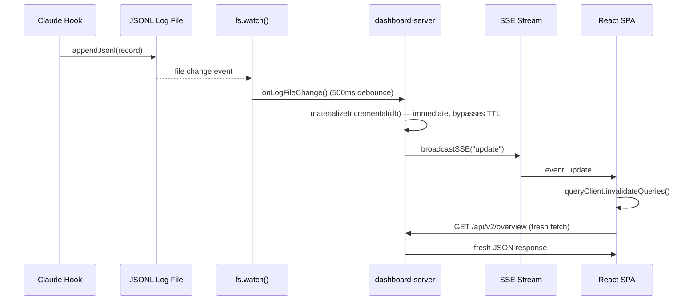

<!-- Verified: 2026-03-17 -->

# Live Dashboard — Server-Sent Events

## Problem

The dashboard relied on polling (15–30s intervals per endpoint) to show new data. Combined with a 15s server-side materialization TTL and React Query's `staleTime`, new invocations could take 30+ seconds to appear — or not appear at all until a hard refresh cleared all cache layers.

## Solution

Replace polling as the primary update mechanism with Server-Sent Events (SSE). The dashboard server watches JSONL log files for changes and pushes update notifications to all connected browser tabs in real time.

## Architecture

## Server Side

### SSE Endpoint

`GET /api/v2/events` returns a `text/event-stream` response. Each connected client gets a `ReadableStreamDefaultController` tracked in a `Set`. On connection, a heartbeat comment (`: connected`) is sent so the client knows the stream is alive.

### File Watchers

`fs.watch()` monitors the three primary JSONL logs:
- `session_telemetry_log.jsonl`
- `all_queries_log.jsonl`
- `evolution_audit_log.jsonl`

A 500ms debounce timer coalesces rapid writes (e.g., a hook appending multiple records in sequence) into a single materialization + broadcast cycle.

### Immediate Materialization

When a file change fires, `refreshV2DataImmediate()` runs `materializeIncremental(db)` bypassing the TTL throttle. This ensures the next API response contains the freshest data.

### Fan-Out

`broadcastSSE(eventType)` iterates all connected controllers and enqueues the SSE payload. Disconnected clients are silently removed from the set.

### Cleanup

On shutdown (`SIGINT`/`SIGTERM`), all file watchers are closed, SSE client controllers are closed, and debounce timers are cleared before the server stops.

## Client Side

### `useSSE` Hook

A React hook that opens an `EventSource` to `/api/v2/events` and listens for `update` events. On each event, it calls `queryClient.invalidateQueries()` which marks all cached queries as stale and triggers immediate refetches for any mounted queries.

The hook is mounted once in `DashboardShell` (the root layout component).

### Polling as Fallback

All React Query hooks retain `refetchInterval` but relaxed to 60s (was 15–30s). This serves as a safety net if:
- SSE connection drops and `EventSource` is reconnecting
- The server restarts and watchers haven't initialized yet
- The browser doesn't support SSE (unlikely but defensive)

`staleTime` was reduced to 5s (was 10–30s) so that SSE-triggered invalidations result in immediate network requests rather than returning cached data.

## Latency Budget

| Stage | Time |
|-------|------|
| Hook writes JSONL | ~0ms |
| `fs.watch` fires | ~50ms (OS-dependent) |
| Debounce window | 500ms |
| `materializeIncremental` | ~50ms |
| SSE broadcast + network | ~10ms |
| React Query invalidation + fetch | ~100ms |
| **Total** | **~700ms** |

New data appears in the dashboard within ~1 second of a hook writing to disk.

## Files Changed

| File | Change |
|------|--------|
| `cli/selftune/dashboard-server.ts` | SSE endpoint, file watchers, immediate materialization, broadcast, cleanup |
| `apps/local-dashboard/src/hooks/useSSE.ts` | New hook — EventSource + query invalidation |
| `apps/local-dashboard/src/App.tsx` | Mount `useSSE` in `DashboardShell` |
| `apps/local-dashboard/src/hooks/useOverview.ts` | Polling 15s → 60s fallback, staleTime 10s → 5s |
| `apps/local-dashboard/src/hooks/useSkillReport.ts` | Polling 30s → 60s fallback, staleTime 30s → 5s |
| `apps/local-dashboard/src/hooks/useDoctor.ts` | Polling 30s → 60s fallback, staleTime 20s → 5s |
| `apps/local-dashboard/src/hooks/useOrchestrateRuns.ts` | Polling 30s → 60s fallback, staleTime 15s → 5s |

## Design Decisions

**Why SSE over WebSocket?** SSE is simpler (plain HTTP, auto-reconnect built into `EventSource`), unidirectional (server→client is all we need), and requires zero additional dependencies. Bun's `Bun.serve` supports streaming responses natively.

**Why 500ms debounce?** Hooks often write multiple records in quick succession (e.g., session-stop writes telemetry + skill usage). Without debounce, each write would trigger a separate materialization + broadcast cycle. 500ms is long enough to coalesce bursts but short enough to feel instant.

**Why invalidate all queries?** A JSONL write could affect any endpoint (overview, skill report, doctor). Targeted invalidation would require parsing the change to determine which queries are affected. Blanket invalidation is simpler and the cost of a few extra fetches is negligible for a local dashboard.

**Why keep polling?** SSE connections can drop. `EventSource` reconnects automatically, but during the reconnect window (up to 3s by default) no updates arrive. The 60s polling fallback ensures the dashboard never goes completely stale.

## Limitations

- File watchers only cover the three primary JSONL logs. Changes to `orchestrate_runs.jsonl` or `evolution_evidence_log.jsonl` still rely on 60s polling.
- `fs.watch()` behavior varies across operating systems. macOS uses `kqueue` (reliable), Linux uses `inotify` (reliable), but some network filesystems may not emit events.
- The debounce means writes within the same 500ms window are coalesced — the dashboard won't show intermediate states within a burst.
